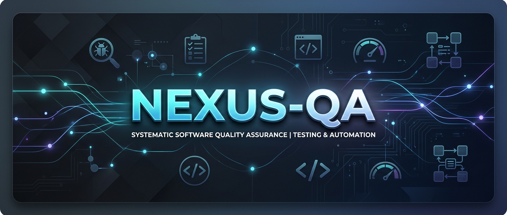
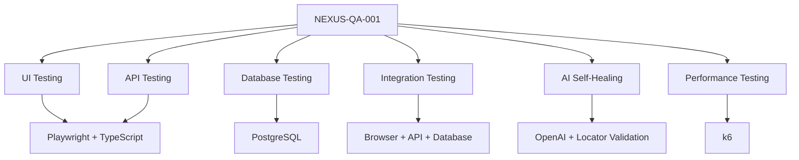
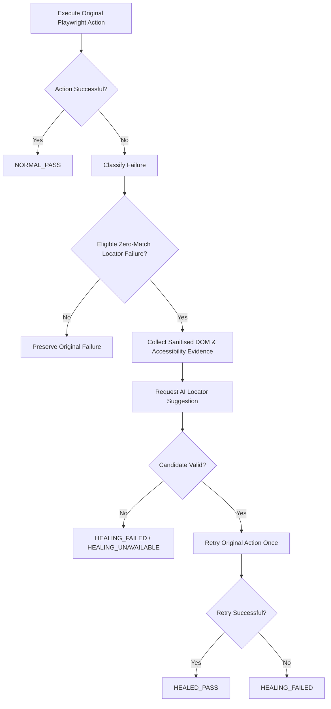
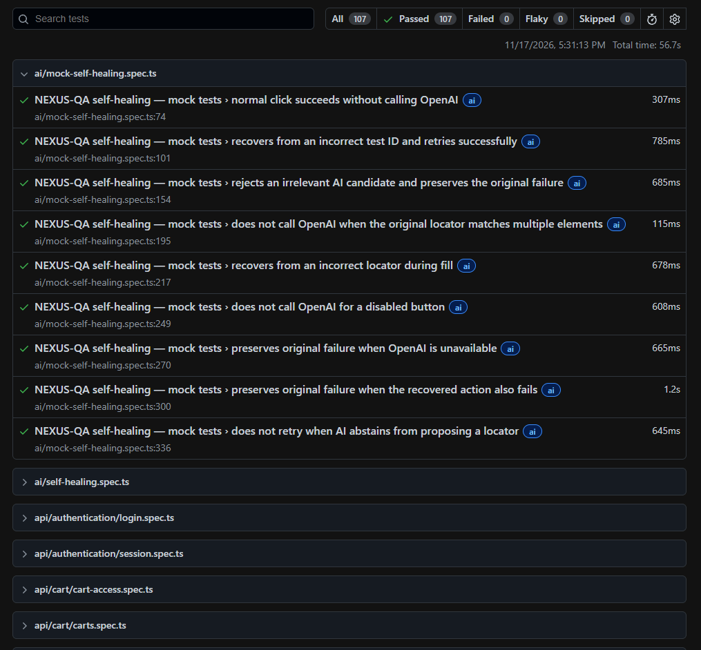
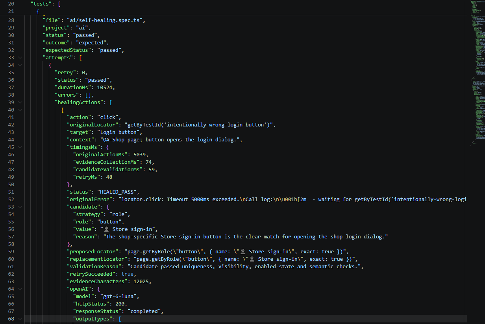
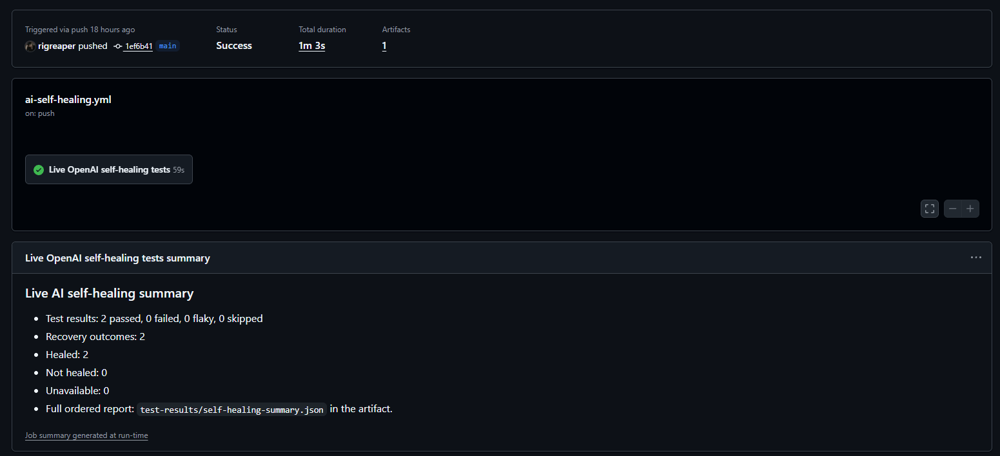

# NEXUS-QA-001

### AI-Augmented Quality Engineering with TypeScript & Playwright

A multi-layer test automation framework for an online shop, combining browser automation, API testing, PostgreSQL validation, cross-layer integration testing, performance testing and AI-assisted locator recovery.

**Repository:** [rigreaper/NEXUS-QA-001](https://github.com/rigreaper/NEXUS-QA-001)


---

## Overview

NEXUS-QA-001 is a practical quality engineering project designed to demonstrate automated testing across multiple application layers.

Built with TypeScript and Playwright, the framework tests a sample online shop through browser workflows, API endpoints, PostgreSQL data checks and cross-layer purchase scenarios.

It also includes an AI-assisted self-healing mechanism that can recover from eligible locator failures through AI-generated locator suggestions, deterministic validation and a controlled retry.

The framework is designed around a simple principle:

**AI can assist test recovery, but deterministic validation remains responsible for deciding whether recovery is safe.**

## Architecture

The project separates test responsibilities across independent testing layers.



### Testing layers

| Layer | Scope | Technology |
|---|---|---|
| UI | Browser workflows and user interactions | Playwright |
| API | Authentication, products, carts, coupons and orders | Playwright API |
| Database | PostgreSQL connectivity and order data validation | PostgreSQL |
| Integration | Cross-layer purchase workflows | Playwright |
| AI | Locator recovery and validation | OpenAI API |
| Performance | API smoke and load testing | k6 |

## Key Features

### 1. Browser Automation

Automated browser workflows covering:

- User login and authentication.
- Product search and sorting.
- Shopping cart operations.
- Checkout workflows.
- Positive and negative scenarios.

Browser tests run using Chromium and Firefox.

### 2. API Testing

API coverage includes:

- Authentication.
- Product retrieval and search.
- Cart operations.
- Coupon validation.
- Order workflows.

The tests validate API responses and expected application behaviour.

### 3. Database Testing

PostgreSQL testing covers:

- Database connectivity.
- Query execution.
- Order data validation.
- Database-level verification of application behaviour.

### 4. Cross-Layer Integration Testing

Integration tests verify workflows across multiple application layers.

The purchase flow connects shop interactions with API behaviour and database verification, helping validate that individual components work together correctly.

### 5. AI-Assisted Self-Healing

NEXUS-QA includes a bounded AI-assisted locator recovery mechanism.

When an eligible locator failure occurs, the framework can request a replacement locator from an OpenAI model and validate it before attempting recovery.

#### Recovery workflow



#### Recovery safeguards

The self-healing mechanism is intentionally restricted:

- Only eligible zero-match locator failures trigger AI recovery.
- DOM and accessibility evidence is sanitised before being sent.
- Candidate strategies are restricted to `getByRole()`, `getByLabel()` and `getByTestId()`.
- Candidates must match exactly one element.
- Visibility, enabled state and semantic consistency are validated.
- Fill actions require an editable element.
- Only one retry is permitted.
- Original test files, assertions and locators are never permanently modified.
- Assertion, API, network, database and unrelated application failures are not healed.
- If AI recovery is unavailable, the original Playwright failure is preserved.

#### Recovery outcomes

| Status | Meaning |
|---|---|
| `NORMAL_PASS` | Original action succeeded |
| `HEALED_PASS` | Replacement locator passed validation and the retry succeeded |
| `HEALING_FAILED` | Recovery was attempted but unsuccessful |
| `HEALING_UNAVAILABLE` | Recovery could not be completed |

Non-eligible failures remain ordinary Playwright failures.

#### AI reporting

Each recovery attempt produces structured reporting with relevant details, including:

- Original locator and action.
- Failure classification.
- AI request status.
- Suggested candidate locator.
- Candidate validation result.
- Retry outcome.
- Original and retry errors where applicable.
- Sanitised evidence.
- Token usage when available.


### 6. Performance Testing

The project includes k6 scripts for API performance checks:

- Smoke testing.
- Ramping virtual-user load testing.
- HTTP failure-rate thresholds.
- Response-time thresholds.
- API response validation.

---

### Playwright HTML Report





### AI Self-Healing Report





### GitHub Actions





---

## Technology Stack

| Category | Technology |
|---|---|
| Programming language | TypeScript |
| Runtime | Node.js 24 |
| Browser automation | Playwright |
| AI integration | OpenAI API |
| Database | PostgreSQL |
| Performance testing | k6 |
| Containerisation | Docker Compose |
| CI/CD | GitHub Actions |
| Test reporting | Playwright HTML and JSON |

## Project Structure

```text
NEXUS-QA-001/
│
├── .github/
│   └── workflows/           # GitHub Actions workflows
│
├── docs/                    # Project documentation
│
├── performance/             # k6 smoke and load scripts
│
├── src/
│   ├── ai/                  # AI-assisted locator recovery
│   ├── config/              # Environment and test configuration
│   ├── data/                # Test data, schemas and factories
│   ├── database/            # PostgreSQL client and queries
│   ├── fixtures/            # Shared Playwright fixtures
│   └── pages/               # Page Object Models
│
├── tests/
│   ├── ai/                  # Mocked and live AI tests
│   ├── api/                 # API tests
│   ├── database/             # Database tests
│   ├── integration/         # Cross-layer tests
│   └── ui/                  # Browser UI tests
│
├── docker-compose.yml
├── playwright.config.ts
├── package.json
└── README.md
```

## Getting Started

### Requirements

- Node.js 24 and npm.
- Docker with Docker Compose plugin.
- Chromium and Firefox browser binaries.
- k6 (optional, for performance testing).

### 1. Clone the repository

```bash
git clone https://github.com/rigreaper/NEXUS-QA-001.git
cd NEXUS-QA-001
```

### 2. Install dependencies

```bash
npm ci
npx playwright install chromium firefox
```

### 3. Configure environment variables

Copy the example environment file.

**PowerShell**

```powershell
Copy-Item .env.example .env
```

**macOS / Linux**

```bash
cp .env.example .env
```

Configure the local database connection in `.env`:

```dotenv
DB_HOST=localhost
DB_PORT=5433
DB_NAME=qashop
DB_USER=qashop
DB_PASSWORD=qashop
```

The OpenAI configuration is optional for the regular suite.

Never commit real credentials or API keys.

### 4. Start the local API and database

```bash
docker compose up -d --wait
```

### 5. Execute the test suite

```bash
npm test
```

The browser tests use the demo shop at `https://learnqa.dev` by default.

The local API defaults to `http://localhost:4000`.

Both URLs can be overridden through environment variables.

---

## Running Tests

| Command | Description |
|---|---|
| `npm test` | All configured Playwright projects |
| `npm run test:api` | API tests |
| `npm run test:chromium` | Chromium UI tests |
| `npm run test:firefox` | Firefox UI tests |
| `npx playwright test --project=database` | Database tests |
| `npx playwright test --project=integration` | Integration tests |
| `npx playwright test tests/ai/mock-self-healing.spec.ts --project=ai` | Mock AI recovery tests |
| `npm run typecheck` | TypeScript type checking |
| `npm run test:report` | Open the latest HTML report |

To run an individual test file:

```bash
npx playwright test tests/ui/inventory/product-search.spec.ts --project=chromium
```

The full suite includes the configured AI project. Live AI integration tests are skipped when the required OpenAI configuration is unavailable.

Playwright generates its HTML report in `playwright-report/` and test result artifacts in `test-results/`.

## Live AI Integration Tests

To enable real OpenAI integration tests, configure both variables in `.env`:

```dotenv
OPENAI_API_KEY=your_api_key
OPENAI_MODEL=your_model
```

Run the live integration tests:

```bash
npx playwright test tests/ai/self-healing.spec.ts --project=ai
```

Live tests require a valid API key, model configuration and internet access.

Read [AI Self-Healing Documentation](docs/AI-Self-Healing.md) for further implementation details.

**Security:** Never commit `.env` or expose API keys in test reports, screenshots or source control.

## Performance Testing

Install [k6](https://grafana.com/docs/k6/latest/set-up/install-k6/) to execute the optional performance scripts.

With the local API running:

```bash
k6 run performance/smoke.js
k6 run performance/load.js
```

To target another API URL:

```bash
k6 run -e BASE_URL=http://localhost:4000 performance/smoke.js
```

Both scripts use `http://localhost:4000` by default.

## Continuous Integration

GitHub Actions provides automated test execution and a dedicated live AI self-healing workflow.

The project includes:

- Playwright test execution.
- Browser installation and dependency setup.
- API and database service setup for the general test workflow.
- Dedicated live AI integration testing.
- AI recovery outcome summarisation.
- HTML and JSON report artifacts.

The live AI workflow requires an `OPENAI_API_KEY` repository secret and the configured `OPENAI_MODEL` repository variable.

The AI workflow is path-filtered and also supports manual execution.

Fork pull requests do not receive the repository's OpenAI secret.

## Engineering Principles

NEXUS-QA-001 follows several implementation principles:

- **Deterministic first:** Normal Playwright automation remains the primary testing mechanism.
- **Bounded AI usage:** AI is only invoked for explicitly eligible recovery scenarios.
- **Validated recovery:** AI suggestions are never trusted without deterministic checks.
- **Failure transparency:** Original failures remain visible when recovery is unsuccessful.
- **Separation of concerns:** UI, API, database, integration and AI responsibilities are organised separately.
- **Reproducibility:** Tests and execution instructions are designed to be repeatable.


