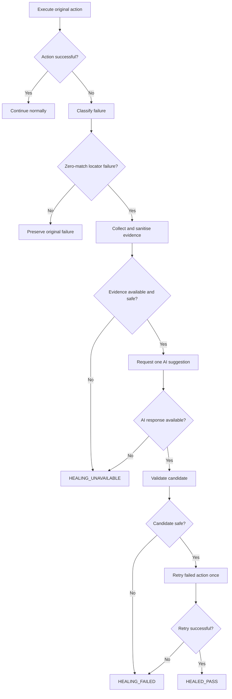

# NEXUS-QA — AI Self-Healing Locators

**Version:** 1.0  
**Component:** AI-Assisted Locator Recovery  
**Status:** Specification

## 1. Overview

NEXUS-QA includes an AI-assisted self-healing mechanism designed to recover from specific Playwright locator failures.

In UI automation, tests can become fragile when an application's DOM structure, accessible names, or test attributes change. A locator that previously worked may stop identifying its intended element, causing an otherwise valid test to fail.

The self-healing mechanism attempts to recover from these failures by analysing the failed action and relevant page evidence, then asking an AI model to propose a replacement locator.

The proposed locator is not trusted automatically. NEXUS-QA validates it using deterministic checks before allowing the failed action to be retried.

The mechanism is designed to improve locator resilience without hiding genuine application failures, weakening assertions, or modifying test source code.

**The primary engineering principle is reliability over recovery rate.** If a replacement locator cannot be verified confidently, the system must reject it and preserve the original failure.

---

## 2. Design Goals

The implementation follows these principles:

- **Failure-triggered:** AI is only called for eligible zero-match locator failures.
- **Explicit intent:** Tests describe the intended element using a human-readable target.
- **Limited scope:** Version 1 supports `click` and `fill` actions.
- **Deterministic validation:** AI suggestions must pass strict validation before use.
- **Single suggestion:** AI may propose only one replacement locator per eligible failure.
- **Single retry:** The failed action is retried at most once.
- **Runtime-only recovery:** Replacement locators are temporary and never modify test source code.
- **Failure transparency:** Genuine application and assertion failures remain failures.
- **Cost awareness:** Successful actions do not require AI requests.
- **Graceful degradation:** Normal Playwright execution works without AI credentials.

---

## 3. Architecture and Responsibilities

NEXUS-QA separates AI decision support from actual test execution.

| Component | Responsibility |
|---|---|
| Playwright | Executes browser actions and interacts with page elements |
| Failure classifier | Determines whether a failure is eligible for recovery |
| Evidence collector | Collects relevant DOM and accessibility information |
| AI service | Proposes one possible replacement locator |
| Deterministic validator | Checks whether the proposed locator is safe |
| Recovery executor | Retries the failed action once |
| Reporting | Records the original failure and recovery outcome |

The AI does not control Playwright directly.

Its responsibility is limited to proposing a replacement locator. Deterministic code decides whether that suggestion is acceptable.

---

## 4. Usage

Self-healing actions are exposed through the `nx` API.

### 4.1 Click

```ts
await nx.click(
  page.getByTestId('login-submit'),
  {
    target: 'Login submit button',
    context: 'Store login form',
  },
);
```

### 4.2 Fill

```ts
await nx.fill(
  page.getByTestId('email-input'),
  {
    target: 'Email input',
    context: 'Store login form',
  },
  'user@example.com',
);
```

### 4.3 Target and Context

| Property | Required | Purpose |
|---|---|---|
| `target` | Yes | Describes the element the test intends to interact with |
| `context` | No | Describes the component, form, or area where the element belongs |

The original locator is used for the initial action.

The target and context provide semantic information that helps the AI identify the intended element if the original locator stops matching.

For example:

- Good target: `Login submit button`
- Poor target: `button-3`
- Useful context: `Store login form`

Clear descriptions improve the quality of recovery decisions.

---

## 5. Recovery Workflow

The recovery process follows a controlled sequence.

1. Execute the original Playwright action.
2. If the action succeeds, continue normally without calling AI.
3. If it fails, inspect the failure locally.
4. Determine whether it is an eligible zero-match locator failure.
5. Collect and sanitise relevant DOM and accessibility evidence.
6. Send the evidence, original locator, target, and context to the configured AI model.
7. Receive one proposed replacement locator.
8. Validate the proposed locator using deterministic checks.
9. If validation succeeds, retry only the failed action once.
10. Record the recovery outcome in the test report.

### Recovery flow



A successful recovery allows the test to continue. It does not guarantee that the entire test will pass.

---

## 6. Failure Classification

Not every Playwright failure should trigger AI.

NEXUS-QA uses a conservative failure classification policy to prevent unnecessary AI requests and avoid hiding genuine application defects.

| Failure type | Trigger AI? | Explanation |
|---|---|---|
| Locator returns zero matches | Yes | The original locator may be outdated or incorrect |
| Multiple matches / strict-mode violation | No | The locator is ambiguous |
| Element not visible | No | May indicate an application or UI-state problem |
| Element disabled | No | May be a genuine application condition |
| Element detached | No | May be caused by DOM lifecycle or timing |
| Click intercepted / overlay | No | Indicates an interaction or UI-state problem |
| Assertion failure | No | The application or test expectation must be investigated |
| API / network / database failure | No | Outside the scope of locator recovery |
| Genuine application failure | No | Must remain visible as a test failure |

**Only zero-match locator failures are eligible for AI recovery in v1.0.**

If the failure cannot confidently be classified as an eligible locator failure, AI must not be called.

---

## 7. AI Evidence and Candidate Generation

When an eligible failure occurs, NEXUS-QA collects relevant evidence to help the AI identify the intended element.

### 7.1 Evidence provided to AI

The recovery request may contain:

- Original locator.
- Intended target.
- Test context.
- Original Playwright error.
- DOM evidence.
- Accessibility evidence.
- Failed action type (`click` or `fill`).

Screenshots and visual AI analysis are not included in v1.0.

### 7.2 Supported locator strategies

AI may propose only the following Playwright locator strategies:

| Strategy | Example |
|---|---|
| `getByRole()` | `getByRole('button', { name: 'Login' })` |
| `getByLabel()` | `getByLabel('Email address')` |
| `getByTestId()` | `getByTestId('login-submit')` |

CSS selectors, XPath, `getByText()`, and `getByPlaceholder()` are outside the v1.0 candidate-generation scope.

### 7.3 AI abstention

AI must be allowed to reject a recovery when the available evidence is insufficient or ambiguous.

It must not:

- Guess the closest matching element.
- Return multiple alternative candidates.
- Suggest an unrelated element simply to produce a result.
- Treat technical uniqueness as proof of semantic correctness.

If AI cannot identify a reliable candidate, the recovery must stop.

---

## 8. Candidate Validation and Safety

An AI-generated locator is only a suggestion. Deterministic validation decides whether it can be used.

Before retrying, the candidate must satisfy all applicable checks.

### 8.1 Validation requirements

1. **Uniqueness:** Exactly one element must match.
2. **Visibility:** The element must be visible.
3. **Enabled state:** The element must be enabled.
4. **Semantic correctness:** The candidate must match the intended target.
5. **Contextual correctness:** The candidate must belong to the intended component or context.
6. **Editability:** For `fill()` actions, the element must be editable.

When context is provided, validation should take place within the intended component whenever possible.

For example, if the intended target is a login button inside a login form, an unrelated button elsewhere on the page must not be accepted.

### 8.2 Strict rejection

A candidate must be rejected if:

- It matches multiple elements.
- It is invisible or disabled.
- It does not match the intended meaning.
- It belongs to an unrelated component.
- Its correctness cannot be established confidently.

If validation fails:

- Stop immediately.
- Do not request another candidate.
- Do not retry the action.
- Preserve the original Playwright failure.
- Record `HEALING_FAILED`.

Reliability takes priority over recovery rate.

---

## 9. Recovery Limits

NEXUS-QA applies strict limits to prevent uncontrolled recovery loops and unnecessary API costs.

| Rule | v1.0 limit |
|---|---|
| AI requests per eligible failure | 1 |
| Candidate suggestions per failure | 1 |
| Action retries per failure | 1 |
| Alternative candidates | Not allowed |
| Recursive healing | Not allowed |
| Repeated AI requests | Not allowed |
| Whole-test restart for recovery | Not allowed |

### 9.1 Multiple failures in one test

Each distinct eligible zero-match failure may receive its own recovery attempt.

For example, if a test encounters four separate eligible locator failures:

- Maximum AI requests: 4.
- Maximum replacement candidates: 4.
- Maximum action retries: 4.

Each failure receives only one attempt. A failed recovery cannot trigger another attempt for the same failure.

### 9.2 Retry only the failed action

NEXUS-QA retries only the action that originally failed.

It does not restart the entire test.

If the recovered action succeeds, the test continues from the next step. This avoids repeating earlier actions that may have side effects, such as submitting forms or creating records.

---

## 10. Runtime Behaviour and Source-Code Protection

Replacement locators are temporary.

When a candidate passes validation, NEXUS-QA uses it only in memory during the current test execution.

The mechanism must never:

- Modify the original test source.
- Modify application source code.
- Automatically apply permanent locator fixes.
- Change assertions or expected results.
- Suppress genuine application failures.
- Bypass application validation.

Permanent locator corrections remain a developer responsibility.

### Example

Suppose the original locator is:

```ts
page.getByTestId('old-login-button')
```

The locator returns zero matches.

AI proposes:

```ts
page.getByRole('button', { name: 'Login' })
```

If the replacement passes all validation checks, NEXUS-QA retries the failed action using that locator temporarily.

The original test file remains unchanged.

---

## 11. Failure and Availability Handling

### 11.1 Candidate validation failure

If the proposed locator is invalid or unsafe:

- Stop recovery immediately.
- Preserve the original Playwright error.
- Record the validation rejection reason.
- Set healing status to `HEALING_FAILED`.

### 11.2 Retry failure

If the replacement locator passes validation but the retried action fails:

- Do not request AI again.
- Do not retry again.
- Preserve the original Playwright error.
- Record the retry error separately.
- Set healing status to `HEALING_FAILED`.

Both errors are important for debugging.

### 11.3 AI service unavailable

Examples include:

- Missing API credentials.
- API authentication errors.
- Rate limits or exhausted quota.
- Network errors.
- Request timeouts.
- Invalid AI responses.

When AI is unavailable:

1. Do not use a replacement locator.
2. Preserve the original Playwright failure.
3. Record `HEALING_UNAVAILABLE`.
4. Do not repeat the AI request.
5. Allow the remaining CI test suite to continue.

### 11.4 Evidence collection failure

If the required DOM or accessibility evidence cannot be collected reliably:

- Do not call AI with incomplete evidence.
- Preserve the original Playwright failure.
- Record `HEALING_UNAVAILABLE`.
- Continue the remaining CI tests.

---

## 12. Evidence Security and Size Limits

DOM and accessibility evidence may contain sensitive information.

Before evidence is sent to an external AI service or attached to a CI report, it must be sanitised.

Sensitive information includes:

- Passwords.
- Authentication tokens.
- Cookies.
- Session identifiers.
- Authorization data.
- Sensitive form and input values.
- Other confidential application data.

### Evidence requirements

| Requirement | v1.0 rule |
|---|---|
| DOM evidence | Sanitised |
| Accessibility evidence | Sanitised |
| AI request evidence | Sanitised |
| CI report evidence | Sanitised |
| Maximum evidence size | 12 KB |

The 12 KB limit is a strict byte limit, not simply a character-count limit.

If sanitisation fails, the evidence must not be transmitted or attached in an unsanitised form. Healing must stop safely and be recorded as `HEALING_UNAVAILABLE`.

---

## 13. Recovery Outcomes and Statuses

NEXUS-QA distinguishes between normal action execution and AI recovery outcomes.

| Status | Meaning |
|---|---|
| `NORMAL_PASS` | The original action succeeded without healing |
| `HEALED_PASS` | A validated replacement locator successfully completed the retried action |
| `HEALING_FAILED` | Recovery was attempted but candidate validation or the retry failed |
| `HEALING_UNAVAILABLE` | AI or required evidence was unavailable, preventing recovery |

The healing status and the overall Playwright test result are separate.

For example:

1. The login button locator fails.
2. AI proposes a replacement.
3. Validation succeeds.
4. The retry succeeds.
5. A later account-balance assertion fails.

The login action is recorded as `HEALED_PASS`, but the overall Playwright test remains `FAILED`.

A successful healing action must never override a genuine later test failure.

---

## 14. Reporting

Recovery activity must be visible and auditable.

NEXUS-QA produces two reporting outputs:

- Structured JSON attachments for machine-readable results.
- Readable console output for quick inspection of CI logs.

### 14.1 Individual recovery record

Each recovery record should contain:

| Field | Purpose |
|---|---|
| Test name | Identifies the affected test |
| Original locator | Records the locator that failed |
| Original error | Preserves the initial Playwright error |
| Target | Records the intended element |
| Context | Records the intended component or location |
| Candidate | Records the proposed replacement, if any |
| Validation result | Explains why the candidate was accepted or rejected |
| AI request status | Records whether the AI request succeeded |
| Retry result | Records whether the retried action passed |
| Retry error | Records the retry failure, if applicable |
| Healing status | Records the final recovery outcome |
| DOM evidence | Contains sanitised relevant DOM evidence |
| Accessibility evidence | Contains sanitised accessibility evidence |

### 14.2 CI summary

The consolidated CI report should distinguish:

- Normal passes.
- Healed passes.
- Failed recovery attempts.
- AI service unavailable events.
- Overall failed tests.
- Affected locators.
- AI request and token usage, where available.

A successfully healed action must remain visible in the report, even when the overall test passes.

### 14.3 No persistent healing history

Version 1 does not require:

- A separate database.
- A persistent healing history service.
- Cross-run healing analytics.

Healing records are limited to the current test execution and its CI report.

---

## 15. CI Configuration

OpenAI is an optional enhancement to the NEXUS-QA framework.

Self-healing becomes available automatically when an OpenAI API key is configured.

If no API key is present:

- Normal Playwright tests still run.
- AI recovery is unavailable.
- No AI request is made.
- The framework does not fail simply because AI credentials are missing.

### 15.1 Environment configuration

Example local environment configuration:

```env
OPENAI_API_KEY=your_api_key
OPENAI_MODEL=your_model
```

The API key must never be committed to the repository or printed in CI logs.

For local development, use an environment file excluded from Git.

### 15.2 GitHub Actions

The real AI integration should use GitHub Actions Secrets.

Configure the API key in the repository's GitHub Actions settings and expose it to trusted workflows through environment variables.

AI credentials must only be made available to trusted workflows. Pull requests from untrusted forks must not receive repository secrets.

Normal tests must remain independent of OpenAI configuration.

---

## 16. Testing Strategy

The self-healing mechanism should be tested at two levels.

### 16.1 Deterministic mock tests

Mock-based tests verify behaviour consistently without relying on external AI responses.

Important scenarios include:

- Normal successful action without AI requests.
- Zero-match locator failure triggers AI.
- Multiple-match failure does not trigger AI.
- Invalid candidate rejection.
- Ambiguous candidate rejection.
- Semantically incorrect candidate rejection.
- Contextually incorrect candidate rejection.
- Invisible or disabled candidate rejection.
- AI abstention.
- AI service timeout and API errors.
- Evidence collection failure.
- Evidence sanitisation failure.
- Evidence size limit enforcement.
- Retry failure.
- Original and retry error preservation.
- Multiple distinct eligible failures in one test.
- Later assertion failure after successful recovery.

These tests must be deterministic and must not depend on random AI behaviour.

### 16.2 Real AI integration tests

Dedicated showcase tests exercise the actual OpenAI integration.

**Self-healing success**

A deliberately broken locator is supplied with a valid target description. The AI analyses the available evidence, proposes a replacement locator, and the validated retry completes the action.

Expected result:

- The original locator fails.
- AI proposes one replacement.
- Deterministic validation approves it.
- The retry succeeds.
- The action is recorded as `HEALED_PASS`.

**Self-healing rejection**

A controlled scenario exercises the real AI request while ensuring that an unsafe or unsuitable candidate is rejected by deterministic validation.

Expected result:

- The recovery attempt is recorded.
- An unsafe candidate is rejected.
- The original failure is preserved.
- No additional suggestion or retry occurs.

The test must not depend on AI randomly returning an incorrect answer. Safety rejection should be verified deterministically through controlled fixtures or candidate responses.

The live CI workflow exercises two successful locator-recovery scenarios. Its job summary aggregates test and recovery outcomes. The uploaded artifact contains the HTML Playwright report, per-test traces, and one ordered `self-healing-summary.json` with each test result and its healing details.

---

## 17. Limitations and Non-Goals

Self-healing is not a replacement for stable test design.

It cannot guarantee recovery when:

- The intended element no longer exists.
- The application's behaviour has fundamentally changed.
- Evidence is insufficient to identify the intended element.
- Multiple elements could reasonably match the target.
- The failure is caused by application logic rather than locator identification.
- The AI service is unavailable.

The following capabilities are explicitly outside the scope of v1.0:

- Visual or screenshot-based AI healing.
- CSS and XPath locator generation.
- Multiple AI candidates.
- Recursive healing.
- Whole-test restart as a recovery strategy.
- Automatic test or application source-code modification.
- Assertion modification or suppression.
- API, network, database, or business-logic healing.
- Multiple AI agents or agent orchestration.
- Persistent healing databases or cross-run history.

Stable test IDs, accessible names, maintainable page objects, and clear assertions remain the preferred foundation for reliable automation.

---

## 18. Definition of Done — v1.0

The self-healing component is considered ready when the following requirements are satisfied:

- [ ] Only zero-match locator failures trigger AI.
- [ ] Multiple-match failures do not trigger AI.
- [ ] Other application, interaction, and assertion failures do not trigger AI.
- [ ] Exactly one AI request is made per distinct eligible failure.
- [ ] AI proposes no more than one candidate and can abstain.
- [ ] Only `getByRole()`, `getByLabel()`, and `getByTestId()` are supported.
- [ ] Candidate uniqueness is verified.
- [ ] Visibility and enabled state are verified.
- [ ] Semantic and contextual correctness are verified.
- [ ] Fill candidates are checked for editability.
- [ ] Evidence is sanitised before transmission and reporting.
- [ ] Evidence is limited to 12 KB.
- [ ] Exactly one retry of the failed action is permitted.
- [ ] The entire test is not restarted for recovery.
- [ ] Original and retry errors are preserved when recovery fails.
- [ ] Replacement locators are temporary and do not modify source files.
- [ ] Genuine later application and assertion failures remain failures.
- [ ] AI unavailability does not interrupt the remaining CI suite.
- [ ] Normal Playwright execution works without OpenAI credentials.
- [ ] JSON attachments and readable console output are produced.
- [ ] Mock tests verify deterministic recovery behaviour.
- [ ] Real integration tests verify the actual AI connection.
- [ ] All relevant tests pass.

---

## 19. Engineering Rationale

The purpose of the NEXUS-QA Self-Healing Agent is to demonstrate a controlled and practical application of AI in software test automation.

Rather than allowing an AI model to control test execution, the system separates responsibilities:

- **Playwright** performs browser actions.
- **Failure classification** determines whether recovery is appropriate.
- **Evidence collection** provides relevant page information.
- **AI** proposes one possible replacement locator.
- **Deterministic validation** decides whether the suggestion is safe.
- **Recovery execution** retries the failed action once.
- **Reporting** preserves visibility into the recovery process.

This architecture keeps AI assistance constrained, observable, and testable.

The objective is not to eliminate every UI test failure. It is to recover from a narrow class of locator failures without hiding genuine application defects, weakening assertions, or compromising test reliability.

**NEXUS-QA prioritises reliable recovery over maximum recovery rate.**